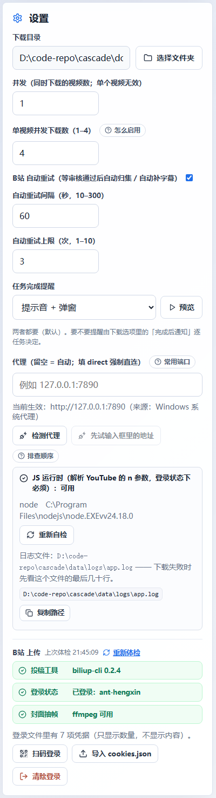

# 设置面板是一条等距平铺列表，五类互不相干的事分不出来

## 问题

设置面板（右栏，390px 轨道 / 内容宽 354px）把九项设置排成一条列表：下载目录、并发、
单视频并发下载数、B站 自动重试三个旋钮、任务完成提醒、代理、代理检测，再接一段
「JS 运行时」与「B站 上传」体检。

用户能观察到的现象是**「找东西只能从上往下读」**：想改代理，得先扫过四个和代理无关的
项；想知道自己改的是不是「影响所有任务」的那个开关，只能逐条读文案。整块面板唯一的
分隔线出现在「B站 上传」之前 —— 那是 `.bili-login-section` 自己的 `border-top`，
不是一条分组规则。

改前与改后（1440×1400，同一后端，只换前端产物）：

| 改前：一条等距平铺列表 | 改后：五个分区 |
|---|---|
|  |  |

- 分区标题：**0 个** → 5 个
- 面板高度：1467px → 1705px
- `.bili-login-section` 上边框：**1px**（全面板唯一一处分隔线）→ 0px

## 原因

不是某一处样式写错了，是**没有任何东西在表达「归属」**：

1. 每一项都是 `.compact-panel` 的直接子元素，`.field { margin-top: 16px }` 一口气给所有项
   同等的间距 —— 组内与组间**同为 16.00px**。间距是列表里唯一的结构信号，它被用平了。
2. 没有任何标题元素：`.panel-title` 是 `h2`「设置」，往下直接是字段标签。文档大纲上
   这九项是平级的九个兄弟。
3. `.bili-login-section` 那条 `border-top` 是**局部补丁**：它只说「这里换了一块」，
   没有说「换到了哪一块」，也无法推广 —— 其余四类事仍然没有边界。
4. 「JS 运行时」长在 `ProxySection` 里，只因为两者共用 `GET /api/diagnostics`。于是
   「代理填什么」与「本机装没装 Node」挤在同一个视觉块里 —— 数据同源被当成了功能同类。

## 修复方案

### 分区（按「作用对象」这一个维度，不混用其他维度）

| 顺序 | 分区 | 作用对象 | 项 |
|---|---|---|---|
| 1 | 下载与存储 | 文件怎么落地 | 下载目录、并发、单视频并发下载数 |
| 2 | 代理与网络 | 请求从哪出去 | 代理地址、当前生效、两个检测按钮、排查顺序 |
| 3 | 完成提醒 | 跑完怎么告知 | 提醒方式、预览 |
| 4 | B站 上传 | 平台账号与投稿链路 | 登录与投稿工具体检、扫码/导入、自动重试三旋钮 |
| 5 | 运行环境 | 这台机器组件齐不齐 | JS 运行时、重新自检、日志文件 |

**只用「作用对象」一个维度**。混用「基本 / 高级」会把同一件事拆到两处（例如把「并发」
留在基本、把「单视频并发下载数」放进高级），用户改吞吐时要在两区之间来回找。

**顺序 = 使用频率 × 用户旅程的先后**：下载目录与并发是每次建任务都会碰的；代理只在
连不上时才看；提醒一次设定后长期不改；B站 上传只有投稿用户用得上，而且得等下载跑通；
运行环境是排障入口，放最后不打扰。

**命名用功能域的名词短语**，不用「常规 / 其他 / 高级」这类没有信息量的词。「其他」不是
一个分区 —— 它只是承认自己没想清楚。

### 结构（`SettingsGroup.tsx`）

```tsx
<section className="settings-group" aria-labelledby="settings-group-storage">
  <h3 className="settings-group-title" id="settings-group-storage">
    <Folder size={15} aria-hidden="true" />下载与存储
  </h3>
  <div className="settings-group-body">…</div>
</section>
```

- `section` + `aria-labelledby` → `role="region"`：分组不只是画一道线，读屏用户要能按区
  跳转，并知道某个控件属于哪一区。`div` 给不了这个语义。
- 标题是 `h3`：面板标题是 `h2`，分区必须低一级 —— 视觉层级与文档大纲是同一件事。
- 五个分区的标题都来自各自的 `h3`，不另存一份字符串。

### 视觉（三样东西一起成立）

| 手段 | 实现 |
|---|---|
| 标题 | 12.5px / 850 / `#62718a`，比字段标签（13px / 800 / `#334155`）**更小更淡** |
| 分隔线 | `.settings-group + .settings-group { border-top: 1px solid #e8edf6 }` |
| 间距差 | 组内 16px（grid gap，并把 `.field` 自带的 16px 上边距清零）；组间 16 + 16 + 1px |

标题做成「旁注」而不是「更粗的正文」，是因为分区标题回答「这一段讲什么」，字段标签才是
用户要读的那一行；两者同为 13px/800 时只剩图标能区分。

**间距差是真正的判据**。只加标题、不拉间距，滚动时标题看起来只是列表里的一行加粗字。
`.field` 自带 `margin-top: 16px`，组内若不清零，两者叠加正好 32px ≈ 组间距离，分区白做。

**不选另外三种做法**：

- **每区一个带边框的卡片**：面板本身已经是卡片，354px 宽的栏里再嵌五张卡片，横向要再让
  出 2×12px 内边距，且「卡片套卡片」会把层级画成三层。iOS / macOS 的设置用「留白 + 发丝线」
  分区，不是再包一层盒子。
- **可折叠手风琴**：设置面板的价值是「一眼看全、按需修改」。默认收起会把九项里的七项藏起来，
  用户得先猜自己在哪一区；还要额外存折叠状态。面板总高 1705px，远没到必须折叠的程度。
- **拆成「基本 / 高级」两页**：这是按「专业程度」分组，会把同一件事拆散（见上），而且
  「高级」会成为新的垃圾桶。

### 顺带的两处

- `RuntimeSection.tsx`：把 JS 运行时与日志从 `ProxySection` 拆出来，单独成「运行环境」区。
  同时删掉 `ProxySection` 上两个从未被使用的 props（`onDraftProxyChange` / `onSettingsChange`）。
- `BiliLoginSection` 的块标签由「B站 上传」改成「登录与投稿工具」：同一个词在分区标题与
  块标签上各出现一次，层级就没了。它自己的 `border-top` 同时撤掉 —— 分区线已经在上面了，
  留着就是两道杠（实测改后 `border-top-width: 0px`）。

## 效果

同一台机器、同一个后端（8001），只换前端产物；1440×1400：

| 量什么 | 改前 | 改后 |
|---|---|---|
| 分区标题 | 0 个 | **5 个**（都是 `h3`，17.5px 高） |
| 组内间距（中位数） | 16.00px | 16.00px |
| 组间间距（中位数） | **16.00px** | **62.50px** |
| 组内与组间之差 | **0.00px** | **46.50px** |
| 分隔线 | 只有 `.bili-login-section` 的 1px | 4 条（`#e8edf6`）+ 该处归零 |
| 面板高度 | 1467px | 1705px（+238px，五组标题与间距的代价） |
| 整页横向溢出（1440 / 390） | 0px | 0px |
| 面板内部溢出（1440 / 390） | 0px | 0px |

组间 62.50px 的构成：`.field` 底 → 16px margin → 1px 线 → 16px padding → 17.5px 标题 →
12px `margin-bottom` → 下一项顶。实测与算式一致。

「代理（…）→ 任务完成提醒」那一对是 194.50px：中间隔着整块代理检测（结论、两个按钮、
排查顺序浮层），不是空白，不计入间距统计的中位数判读。

## 验证

**自动化（jsdom）**

- `frontend/src/settings/settings-groups.test.tsx`（6 例）：分区顺序、`h3` 与
  `aria-labelledby` 指向一致、九项设置的归属（含**反证**：某项不在别的区）、
  JS 运行时不在代理区、组内交互（试地址 / 关自动重试）后分区不散、保存回执挂在面板级。
- `frontend/src/styles.test.ts` 第 6 条源文不变式：组间必须有 `border-top` 与 `padding-top`，
  组内 `.field` 的上边距必须被清零，标题必须有独立的字重。
- **承重**：把 `.settings-group-body > .field` 的 `margin-top: 0` 改成 `16px` → 该断言立刻
  变红（`expected 'margin-top: 16px' to match /margin-top:\s*0/`）；把 `section` 改回 `div`
  → 上面 6 例里 5 例变红（`Unable to find an accessible element with the role "region"`）。
  两条都实测过，随后已还原。

**真实浏览器（CDP，`tmp_acceptance/ui_settings_groups.py`）**

- 改前 / 改后各量一次九项设置的 `getBoundingClientRect()`，按「标签文字 → 功能域」归类算
  相邻间距；同时读 `getComputedStyle` 的分隔线与标题字号。
- 1440×1400 与 390×844 各量一次 `scrollWidth - clientWidth`：0 / 0。
- 截图：`settings-before-desktop.png` / `settings-after-desktop.png`（面板全高）与
  `settings-*-mobile.png`（390px）。

**回归**：前端全量 **25 文件 / 332 passed**（`--environment jsdom --no-file-parallelism`，
新增 6 例 + 1 条样式不变式）；`tsc --noEmit`、`vite build` 均通过。本次无后端改动。

## 风险与回滚

- 面板高度 +238px（1467 → 1705）。右栏是独立的网格列，下方没有别的面板需要对齐；
  页面本来就靠滚动，不产生折行或溢出（实测 1440 / 390 均为 0px）。
- 分区标题是新的一级标题：任何「用 `h2` 找设置面板」的旧脚本不受影响（面板标题仍是 `h2`），
  但按 `heading` 数量做断言的用例需要知道多了 5 个 `h3` —— 本仓库没有这种用例。
- 回滚：还原 `SettingsPanel.tsx` / `styles.css` 的分区段落即可；`RuntimeSection.tsx` 与
  `SettingsGroup.tsx` 是新增文件，删掉不影响其它模块（`ProxySection` 需恢复运行时块）。

## 关联

- [002](002-side-column-overflow-breaks-the-page.md)：右栏 390px 轨道的宽度约束 ——
  本次分区在 390px 下复测了横向溢出（0px），没有把旧病带回来。
- [009](009-page-level-errors-scroll-out-of-view.md)：同一轮里另一处「用户看不见」的问题；
  那条讲错误回执落在视口外，这条讲设置项之间没有边界。
- `ai/bug-fix/031`（引用自 `BiliLoginSection` 的注释）：页顶旧错误会被读成本次失败 ——
  与「同一词出现在分区标题和块标签上」同属**归属不清**，只是载体不同。

## 未覆盖 / 如实说明

- **中等宽度（1024–1400）没有单独量**：右栏轨道是固定 390px，只在 `max-width: 1020px`
  时折成单列（那条断点由既有探针覆盖）。分区只改纵向结构，理论上不影响该断点，但未实测。
- **390px 的截图被截断**：探针只在面板顶部截 1600px，而 390px 下面板远高于此，
  B站 体检之后的内容不在图里；分区数量与间距由同一份 DOM 测量给出，不靠看图数。
- **没做读屏软件实测**：只验证了 `role` / 可访问名 / 标题层级（`getByRole("region", …)`），
  没有用 NVDA / VoiceOver 走一遍「按区跳转」的真实体验。
- **没量「视觉扫描时间」**：分区是否真的更快找到某一项，属于可用性测试范畴，本记录只有
  间距、标题、分隔线这些结构证据，不主张主观效果。
